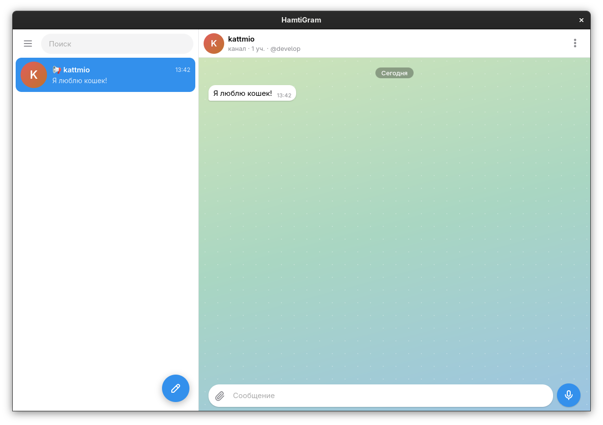

# HamtiGram для компьютера

> [!NOTE]
> В России HamtiGram может быть недоступен из-за проблем с доступом к Cloudflare и возможных ограничений со стороны Роскомнадзора. Для использования сервиса в России рекомендуется подключаться через VPN или прокси.



Открытый настольный клиент мессенджера HamtiGram для Windows и Linux. Он показывает тот же веб-мессенджер, что и мобильный клиент, в отдельном изменяемом окне. Войдите в свою обычную учётную запись: сообщения и переписки обслуживаются существующим сервисом HamtiGram.

Android-клиент предоставлен в виде распакованного ресурсного дампа APK, а не исходного проекта. По адресу сайта, названию, значку и цветам видно, что он открывает тот же веб-мессенджер. Поэтому настольный клиент также подключается к веб-сервису и не добавляет отдельный сервер переписки.

Уведомления, которые веб-мессенджер создаёт через Web Notifications API, показываются системными средствами: как Windows toast в Windows 10 и новее и через системную службу уведомлений Linux (совместимую с libnotify). Клиент передаёт системному плагину запросы и проверку разрешения, которые уже выполняет веб-мессенджер. Уведомления HamtiGram можно отключить в системных настройках уведомлений.

## Требования

- Windows 10 или новее; установщик включает автономный установщик WebView2.
- Linux с WebKitGTK 4.1 для запуска собранного приложения.
- Rust и системные зависимости Tauri 2, Node.js и npm — для разработки и сборки.

Инструкции по установке инструментов сборки и системных зависимостей: [руководство Tauri](https://v2.tauri.app/start/prerequisites/).

## Запуск для разработки

```sh
npm install
npm run tauri dev
```

## Сборка установщиков

Собрать пакеты Linux `.deb` и `.rpm`:

```sh
npm run tauri build -- --bundles deb,rpm
```

Собрать установщик Windows `*-setup.exe`:

```sh
npm run tauri build -- --bundles nsis
```

Файлы сборки появятся в `src-tauri/target/release/bundle/`. Установщик Windows проверяет, что установлена Windows 10 или новее, и включает автономный установщик WebView2. Это увеличивает размер установщика примерно на 127 МБ.

## Сборки и тестовый выпуск

GitHub Actions автоматически собирает установщики Windows и Linux при каждом обновлении ветки `main`. Чтобы опубликовать установщики как предварительный выпуск `TEST`, откройте раздел **Actions**, выберите workflow **Сборка настольного клиента HamtiGram** и нажмите **Run workflow** («Запустить workflow»).

До отдельного объявления разработчика публикуется только предварительный выпуск `TEST`; стабильный выпуск не создаётся.

## Лицензия

Проект распространяется по лицензии MIT. В файле [LICENSE](LICENSE) сохранён стандартный текст лицензии на английском языке.
